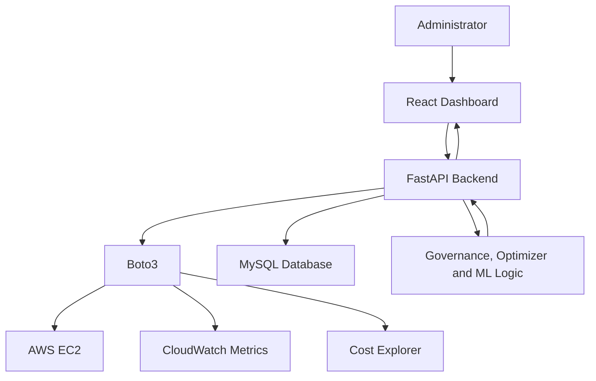

[README.md](https://github.com/user-attachments/files/33525991/README.md)
# CloudCampusAI

CloudCampusAI is an AWS governance and monitoring platform that helps an administrator view cloud resources, identify missing governance tags, review cost-saving recommendations, detect unusual CPU usage, and plan future cloud cost from one dashboard.

## Problem Statement

AWS resource information, monitoring data, and billing details are often spread across multiple service pages. This makes manual monitoring slow and can lead to unused resources, missing ownership information, and unnecessary cloud cost.

CloudCampusAI brings these checks into one application so that an administrator can review the cloud environment and take an informed action.

## Key Features

- **Overview Dashboard**: Shows total, running, stopped, and non-compliant resources along with recommendations, anomaly count, and cost summary.
- **Cloud Resource Inventory**: Displays AWS resource name, ID, state, instance type, ownership information, compliance status, and last sync time.
- **Governance Checks**: Identifies resources missing required tags such as `OwnerEmail`, `Project`, and `Environment`.
- **Resource Optimizer**: Generates recommendations for stopped or idle EC2 instances that may create unnecessary cost.
- **CPU Anomaly Detection**: Uses the Isolation Forest algorithm to identify unusual EC2 CPU-utilization patterns.
- **AWS Cost Forecast**: Uses historical billing information to estimate future cloud cost.

## Technology Stack

| Category | Technologies |
| --- | --- |
| Programming languages | Python, JavaScript, HTML, CSS, SQL |
| Frontend | React, Vite |
| Backend | FastAPI |
| AWS integration | Boto3 |
| AWS services | Amazon EC2, Amazon CloudWatch, AWS Cost Explorer |
| Database | MySQL |
| Machine learning | Isolation Forest |
| Version control | Git and GitHub |

## Architecture



## Workflow

1. The administrator logs in to the dashboard.
2. The application synchronizes AWS resource information.
3. The backend collects CloudWatch metrics and historical cost data.
4. Governance rules, the optimizer, and the ML module analyze the collected data.
5. The dashboard displays resource status, missing tags, recommendations, anomalies, and cost information.
6. The administrator reviews the result and takes the final action.

## Project Status

### Completed

- Frontend dashboard and FastAPI backend
- AWS resource synchronization
- Governance tag checks
- Cost optimization recommendations

### In Progress

- Collecting enough CPU data for reliable anomaly detection
- Collecting at least 14 days of billing history for cost forecasting
- Final testing, error handling, and deployment verification

> The ML anomaly module needs sufficient CPU data points before it can produce reliable results. The forecast module also needs historical billing data before it can generate a meaningful prediction.

## Local Setup

1. Clone this repository.

   ```bash
   git clone <your-repository-url>
   cd CloudCampusAI
   ```

2. Configure valid AWS credentials with permission to read the services used by the application.
3. Configure the MySQL database connection used by the backend.
4. Install backend dependencies from the project's Python requirements file.
5. Install frontend dependencies from the React project's `package.json` file.
6. Start the FastAPI backend and React frontend according to the project configuration.

## Security Note

Do not upload AWS access keys, database passwords, `.env` files, or other secrets to GitHub. Keep sensitive values in environment variables or a local `.env` file that is excluded through `.gitignore`.

## Future Enhancements

- Email or dashboard alerts for high-severity recommendations
- Role-based access control for multiple administrators
- More AWS resource types and compliance rules
- Scheduled data collection and automated reports
- Production deployment with monitoring and logging

## Author

**Krishna Gupta**  
B.Tech CSE, Semester V  
GLA University
